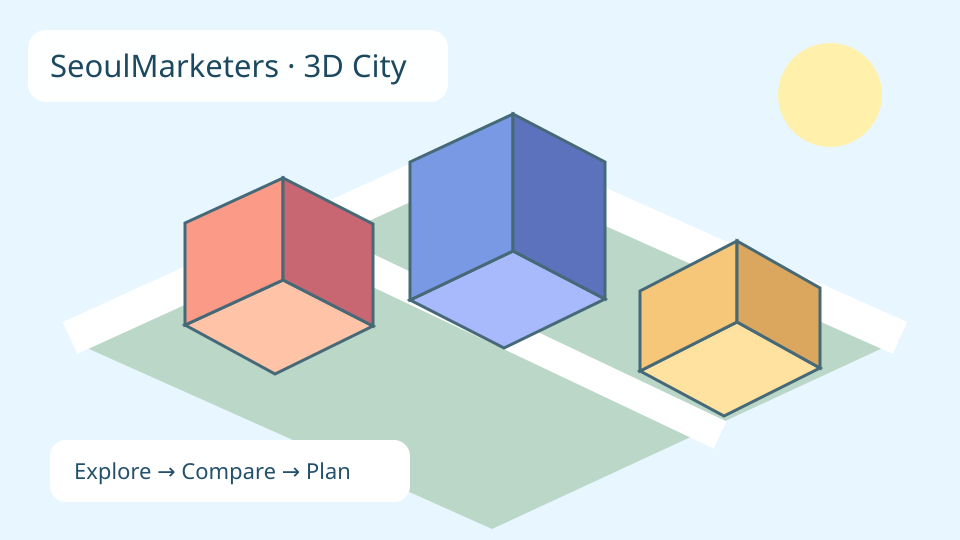

# SeoulMarketers

상권 데이터 + **Three.js 3D 도시 탐색** + 실제 비용·경쟁 구조의 시뮬레이션. 예비 창업자와 기존 사업자를 위한 서비스. 3D는 첫 인상, 검증 가능한 분석이 제품의 신뢰를 만든다.

## 문서
- [제품 요구사항](docs/PRODUCT_REQUIREMENTS.md)
- [데이터·비즈니스 로직](docs/DATA_AND_BUSINESS_LOGIC.md)
- [Three.js 3D UX](docs/THREEJS_UX.md)
- [시스템 아키텍처](docs/ARCHITECTURE.md)
- [검증·로드맵](docs/TEST_AND_ROADMAP.md)

## 초기 범위
서울 일부 지역의 상권·업종 탐색 → 비용 가정 시뮬레이터 → 등록 사업자용 리포트 실험. 공개 데이터만으로 실제 개별 매장 매출·창업 성공 확률을 알 수 없음. 산출물은 의사결정 지원이지 보장 또는 개별 전문 자문이 아니다.

## 배포
Next.js + TypeScript + React Three Fiber/Three.js; PostGIS + Python ETL; Vercel preview, Ubuntu batch. 개인정보/매출자료는 별도 동의·보호 체계 이후에만 연동.

현재 문서 중심 시작 상태이며 구현 여부를 뜻하지 않는다.

## Agent-driven TDD & 학습 문서 (2026-11-22 추가)
- [엔지니어링 원칙: 선언적 코드·가독성·예측 가능성·응집도·결합도](docs/19_ENGINEERING_PRINCIPLES.md)
- [코드 읽기와 실습 순서](docs/20_LEARNING_PATH.md)
- [테스트 증거 기반 품질 게이트](docs/21_QUALITY_GATES.md)
- [PR 단위 구현 백로그](docs/22_IMPLEMENTATION_SPRINTS.md)
- [홈서버 / Vercel / 도메인 운영](docs/23_OPERATIONS_AND_COST.md)
- [Agent 개발 규약](agent/AGENT_RULES.md)
- [작업 템플릿](agent/TASK_TEMPLATE.md)

## 디자인 콘셉트 (오리지널 SVG)

예전 채팅에 표시된 외부 사진과 동일한 이미지가 아닌 **이 저장소를 위해 새로 작성한 콘셉트 SVG**이다. 실제 DB나 작동하는 화면의 스크린샷이 아니다.

## 개발 진행 상태
- 완료: 요구사항/기술 규약/학습 계획 문서 및 오리지널 SVG
- 미완료: 앱 코드, 실제 데이터 계약 검증, TDD 실행 로그, Three.js 실제 렌더러, 자동화 CI, Vercel 배포
- 개발 프로세스: Agent가 테스트 작성→실패 로그→구현→테스트 통과 증명→코드 읽기 문서 제공. 창업자는 기술 승인 부담 없이 학습 및 제품 의견 제공.
